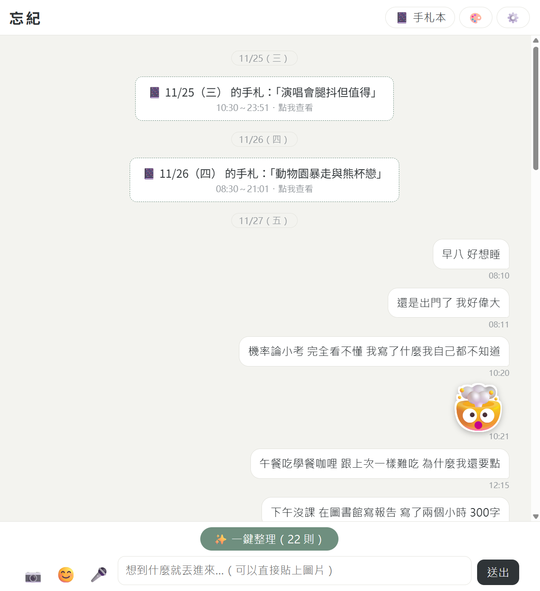
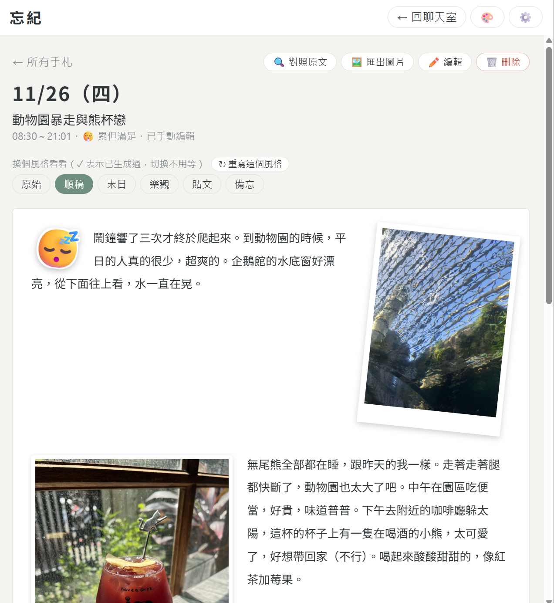
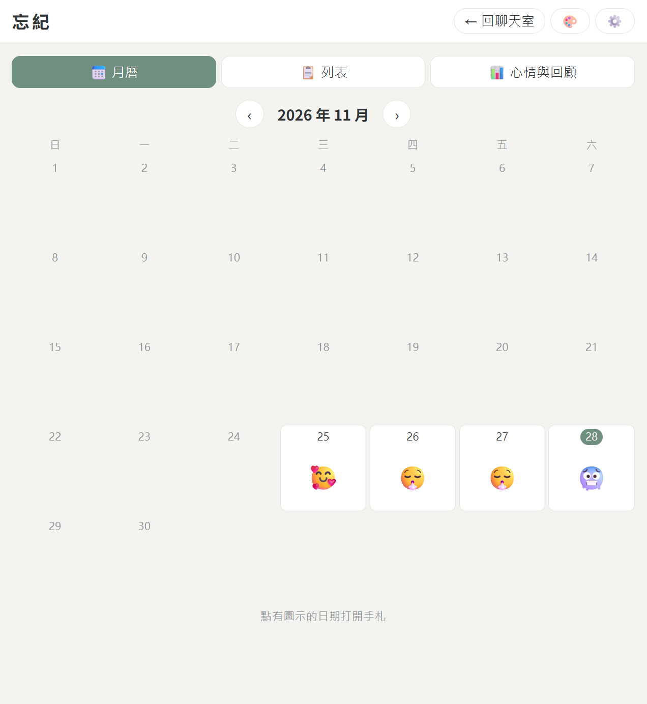
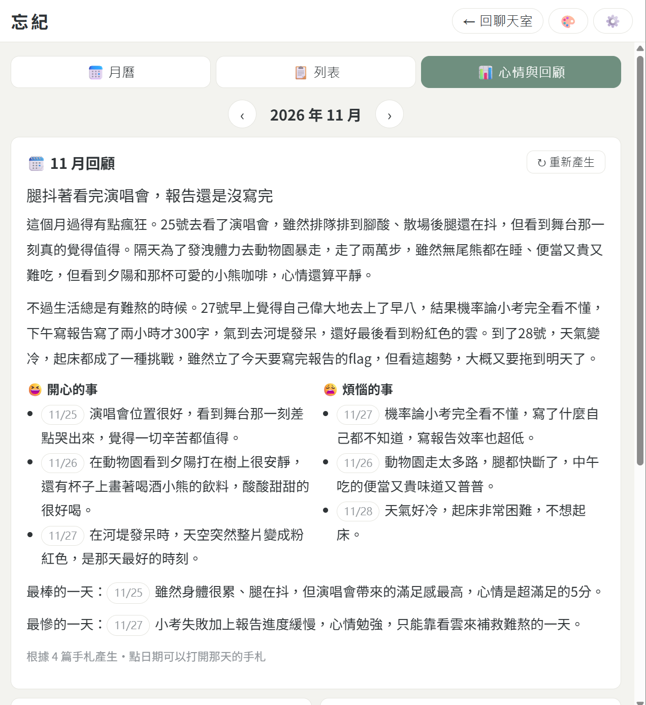
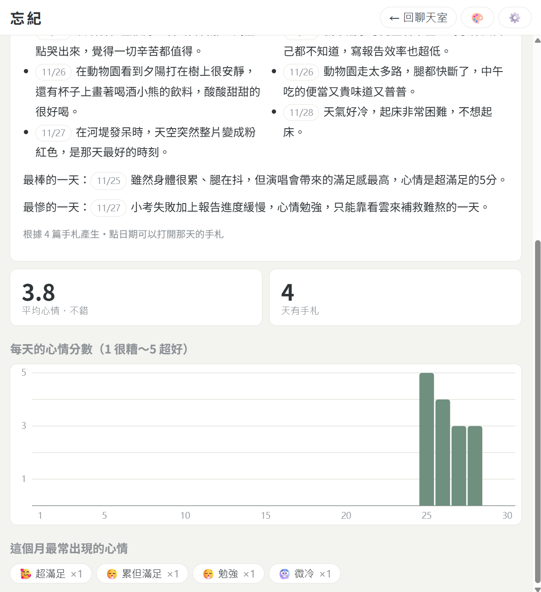
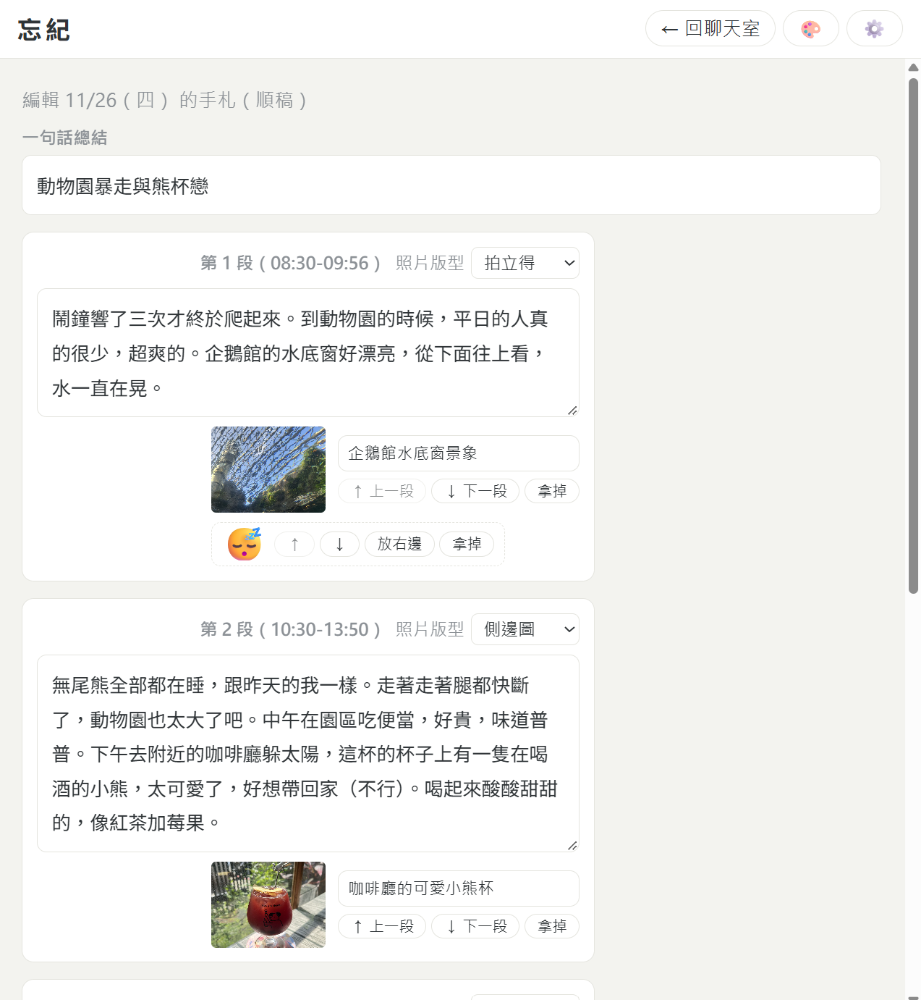
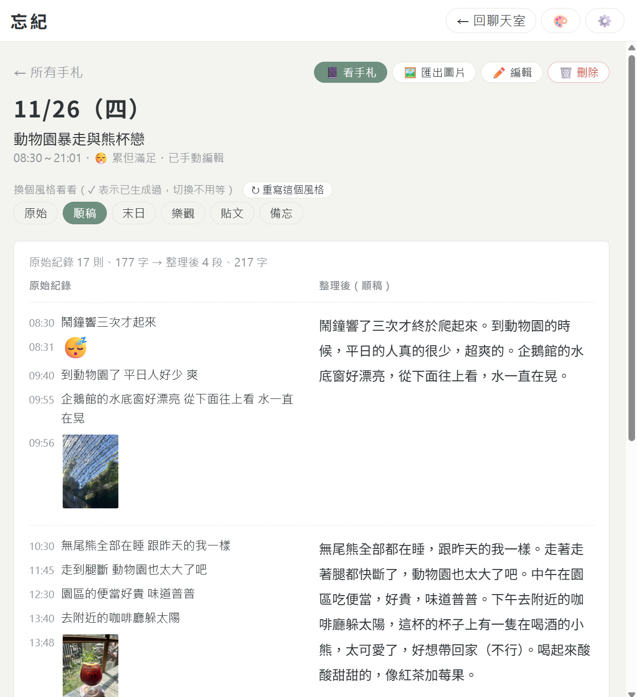
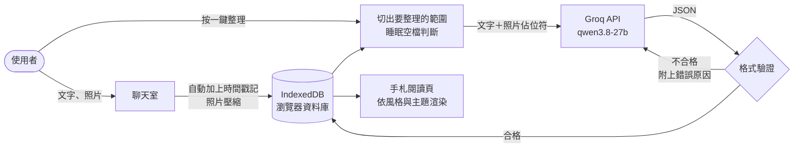
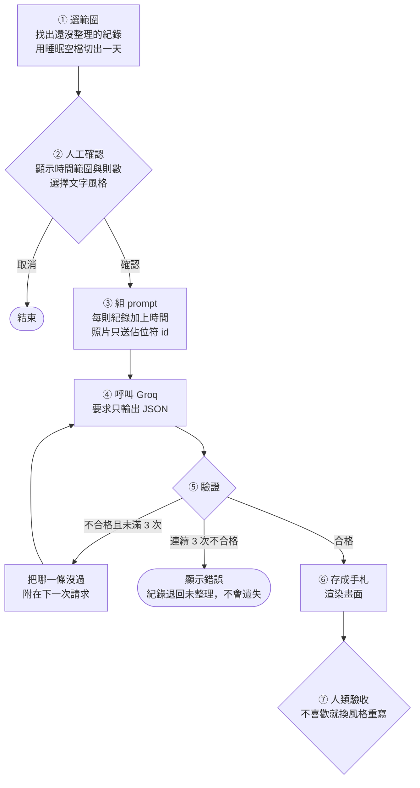

# 忘紀｜隨手忘記也沒關係

> 生成式 AI 課程期末專題 ｜ 政大資管三 吳昀蓁

**線上 Demo**：https://wyz279.github.io/wangji/

像傳訊息一樣隨手丟文字和照片，想整理的時候按一下，AI 就會把一整天的碎碎念整理成一篇圖文手札，而且讀起來還是你自己講話的樣子。

| 聊天室 | 手札 |
|---|---|
|  |  |
| **月曆** | **AI 月回顧** |
|  |  |
| **心情統計** | **手動調整照片與貼紙** |
|  |  |

**原文對照**：左邊是當時的碎碎念，右邊是 AI 整理後的段落



---

## 為什麼做這個

每天都有很多零碎的想法、抱怨、突然的靈感，照片也拍了一堆，但真的要寫日記時又覺得麻煩，不知道從哪裡寫起，最後就放棄了。

忘紀把「記錄」和「整理」拆開：

- **記錄**的時候完全不用想，像傳訊息給自己一樣，想到就丟。
- **整理**交給 AI：濾掉廢話、依主題分段、把照片放回對的時間點，但保留原本的口氣，不會變成官方文章。

---

## 怎麼用

1. 打開網頁，點右上角 ⚙️ 貼上自己的 [Groq API Key](https://console.groq.com/keys)，按「測試連線」確認可用後儲存。
2. 在聊天室打字、傳照片。
3. 按「✨ 一鍵整理」，選一種文字風格，AI 會在背景整理，這段時間可以繼續記錄。
4. 整理好後點提示或聊天室裡的小卡，就能閱讀手札；「📔 手札本」可以用月曆、列表搜尋、心情與月回顧三種方式回顧；右上角 🎨 可以換畫面主題。

> **想快速試用？** 在設定裡按「載入測試資料（4 天份）」，會放進四天份的紀錄、照片和貼圖，按「一鍵整理」選「分天整理」就能一次看到四篇手札。

---

## 功能

### 六種文字風格

同一批紀錄可以在手札頁直接切換風格重寫，生成過的風格會存起來，切回去不用再等。

| 風格 | 效果 |
|---|---|
| 原始 | 一字不改，只幫你分段、下標題、排照片 |
| 順稿 | 去掉冗字、補標點、把句子順過，保留口頭禪和語氣 |
| 末日 | 平淡冷靜的白話，像一個什麼都看開的人在講今天的事 |
| 樂觀 | 極度樂觀，倒楣事也能誇張地找出好處 |
| 貼文 | 短短的 IG／Threads 貼文，附 hashtag |
| 備忘 | 固定分成「發生的事／心情／待辦・想買」三區，方便回顧 |

### 六種畫面主題

牛皮紙復古風、深夜黑金、簡約日系北歐、櫻花手帳、墨綠書房、海鹽藍。

### 其他

- 一天可以整理好幾次，手札依日期分組
- **月曆**：一眼看到哪幾天有手札、每天的心情，點日期直接打開
- **搜尋**：輸入關鍵字（例如「咖哩」），找出所有提到的那幾天，連原始紀錄也搜得到
- **心情統計**：每次整理時 AI 順便判斷那天的心情（emoji＋1～5 分），心情頁畫出這個月每天的心情長條圖和最常出現的心情
- **月回顧**：AI 讀完一整個月的手札，用你的口吻寫回顧：這個月開心的事、煩惱的事、最棒和最慘的一天，點日期就能跳回那天
- **匯出圖片**：把一篇手札存成一張 PNG，方便分享
- **備份與還原**：所有紀錄、照片、手札可以匯出成一個備份檔，換電腦或換瀏覽器時再匯入
- **照片版型**：AI 不看照片，而是從照片前後的訊息推測拍了什麼，再依內容和張數挑版型：大圖橫幅、側邊圖、拍立得、兩張並排、拼貼
- **手動調整**：整理好的手札可以改文字、換照片版型、把照片或貼紙移到別段、換左右、拿掉或放回
- **原文對照**：手札頁一鍵切換，左邊是當時的碎碎念、右邊是整理後的段落，依時間對齊，看得出 AI 整理了什麼
- 可以用 🎤 語音輸入（說完先改再送）、直接 Ctrl+V 貼上圖片，或把圖片拖進聊天室
- 可以傳貼圖（約 380 個分類表情，或上傳自己的），整理後會像貼紙一樣貼在手札裡，AI 也會參考貼圖來抓當下的情緒
- 聊天室背景可以換成自己喜歡的圖片
- 還沒整理的訊息可以點一下修改或刪除；整理好的手札也可以手動修改或刪除（刪除會連同原始紀錄一起刪掉，刪除前會警告）
- 手札頁可以直接切換前一篇／後一篇
- 照片自動壓縮，並去掉照片裡的拍攝時間、地點等資訊
- 所有資料只存在自己的瀏覽器，不會上傳到任何伺服器
- 可以連結電腦上的資料夾（Edge / Chrome），自動把原始紀錄存進 `raw/`、整理後的手札存進 `journals/`（JSON＋Markdown），跟第 11 週 LLM Wiki 的 raw → wiki 是同一個概念

---

## 系統架構

整個網站是**純前端**：HTML／CSS／JavaScript，放在 GitHub Pages，瀏覽器直接呼叫 Groq API，資料存在瀏覽器內建的 IndexedDB。



| 檔案 | 負責 |
|---|---|
| `index.html` | 唯一的頁面：聊天室、手札本、設定 |
| `css/themes.css` | 六種主題的配色（CSS 變數） |
| `css/base.css` | 版面與元件 |
| `js/db.js` | IndexedDB 讀寫 |
| `js/prompts.js` | 六種風格的 prompt |
| `js/generate.js` | 呼叫 Groq、驗證、重試 |
| `js/render.js` | 把資料畫成聊天泡泡和手札 |
| `js/app.js` | 畫面切換、整理流程 |
| `js/sample.js` | 測試資料 |
| `js/stickers.js` | 內建貼圖、自訂貼圖處理 |
| `js/sync.js` | 同步到本機資料夾（raw/、journals/） |
| `SPEC.md` | 開發規格書（資料格式、規則、驗收清單） |

---

## AI 處理流程

整理流程借用了課堂上 Graph & Loop 的概念：拆成幾個節點，在容易出錯的地方設檢查關卡，錯了只退回那一步重做。



### 送給 AI 的內容

```
[11/22 08:40] 公車誤點 遲到十分鐘 老師看了我一眼 好可怕
[11/22 12:15] 午餐吃學餐咖哩 跟上次一樣難吃 為什麼我還要點
[11/22 12:16] [圖片 img_1732249000000]
```

### AI 必須回傳的格式

```json
{
  "title": "遲到又踩雷的一天",
  "mood": { "emoji": "😵", "label": "累爆", "score": 2 },
  "sections": [
    {
      "time_range": "08:40-12:16",
      "refined_text": "公車誤點，遲到十分鐘，老師還看了我一眼，好可怕。午餐又點了學餐咖哩，跟上次一樣難吃，到底為什麼還要點……",
      "matched_images": ["img_1732249000000"]
    }
  ]
}
```

### 驗證規則

AI 說自己做完不算數，程式會逐條檢查：

1. 是合法的 JSON
2. 有標題，段落數在 1～6 段之間
3. 每段都有內容
4. 照片 id 都真的存在（不准編造）
5. 每張照片剛好出現一次
6. 極簡備忘錄只能用三個固定分類，每行都要是條列
7. 不能出現簡體字（原文本來就有的字不算）

不合格就把錯誤原因附在下一次請求裡讓 AI 修正，最多 3 次。每次呼叫都會記進「AI 品質紀錄」（設定裡可以看統計、匯出 CSV）：試了幾次、被哪條規則擋下、花幾秒，只記數字不記日記內容，用來觀察哪些規則最常被觸發、改了 prompt 之後有沒有變好。只有「照片漏放」這種小問題時，程式直接把照片補進時間最接近的段落，不浪費重試次數。

---

## 設計決策

| 決策 | 原因 |
|---|---|
| **照片不送 Vision API** | 只用時間戳記和前後的訊息推測照片內容、決定放哪一段和用哪種版型。省下大量 token、不容易撞到免費額度上限、生成比較快，期末也比較能穩定做完。 |
| **照片時間用上傳時間，不讀拍攝時間** | 不讀照片裡的拍攝資訊比較保護隱私；而且今天想起以前的事、傳了舊照片，也應該記在今天。 |
| **手動按「一鍵整理」，不用半夜自動排程** | 大學生作息不固定，凌晨兩點才睡很正常；自動排程也需要電腦一直開著。 |
| **用「睡眠空檔」判斷一天** | 不照日曆日期切，而是找「隔了 4 小時以上、而且跨過凌晨 3～7 點」的空檔，熬夜到兩點的紀錄才不會被切到隔天，白天上課好幾小時沒記錄也不會被誤判成睡覺。 |
| **照片位置用「段落＋版型＋左右」調整，不做自由拖曳** | 手札會隨視窗寬度重新排版，記住像素位置換個螢幕就會跑掉；用段落和版型控制，在電腦和手機上都好看。 |
| **整理在背景跑** | 按下去之後那批紀錄會先鎖定，新打的訊息不會混進去，可以邊整理邊繼續記。 |
| **「原始」風格不讓 AI 碰原文** | 叫 AI「照抄」它還是會偷改字。所以這個風格只讓 AI 決定哪幾則放同一段，文字由程式用原話拼回去，保證一字不差。 |
| **純前端，不寫後端** | GitHub Pages 跑不了後端；純前端讓人點網址就能用，也少一層要開發和除錯的東西。 |
| **API Key 存在使用者自己的瀏覽器** | Key 不寫進程式碼、不上傳 GitHub，每個人用自己的 Key。 |
| **模型選 qwen3.8-27b** | 實測比較過 openai/gpt-oss-120b：兩者 JSON 都穩定，但 qwen 的中文標題比較有口吻，gpt-oss 會擅自用英文標題。 |

---

## 開發過程

延續課堂上「先討論規格、再寫程式」和「人類驗收優先」的做法：

- 動工前先寫好 [`SPEC.md`](SPEC.md)，資料格式、資料夾結構、驗證規則都寫死，AI 照規格產生程式碼。
- 每個階段都親自打開瀏覽器驗收，抓到問題只退回那一塊修改，例如：
  - 手札列表和閱讀頁同時出現、畫面被切成兩半 → CSS 的 `display:flex` 蓋掉了隱藏效果
  - 「末日」風格寫得太文藝，出現「存在主義危機」「靈魂拷問」→ 改成平淡白話，並禁止比喻和哲學詞
  - AI 寫出簡體字「衣柜」→ 驗證規則加上簡體字檢查
  - 只看「間隔 4 小時」會把白天上課的空檔誤判成睡覺 → 加上「要跨過凌晨 3～7 點」的條件
  - Edge 會把 API Key 當成密碼儲存，之後自動填入舊 Key → 輸入欄改成一般文字欄位加遮罩

---

## 限制

- 需要自己的 Groq API Key（免費申請）。
- 資料存在目前這個瀏覽器；換電腦或清除瀏覽器資料前，記得先用設定裡的「匯出備份」。
- iPhone 的 HEIC 照片在部分瀏覽器無法讀取，請先轉成 JPG。
- AI 看不到照片內容，只能依時間判斷照片屬於哪一段。
- 匯出圖片需要網路（匯出工具 html2canvas 是用到時才載入）。
- 語音輸入只支援 Edge、Chrome 等瀏覽器，而且需要網路；辨識會經過瀏覽器廠商的語音服務。

---

## 本機執行

不用安裝任何東西。下載後直接用瀏覽器打開 `index.html`，或用 VS Code 的 Live Server 開啟。
